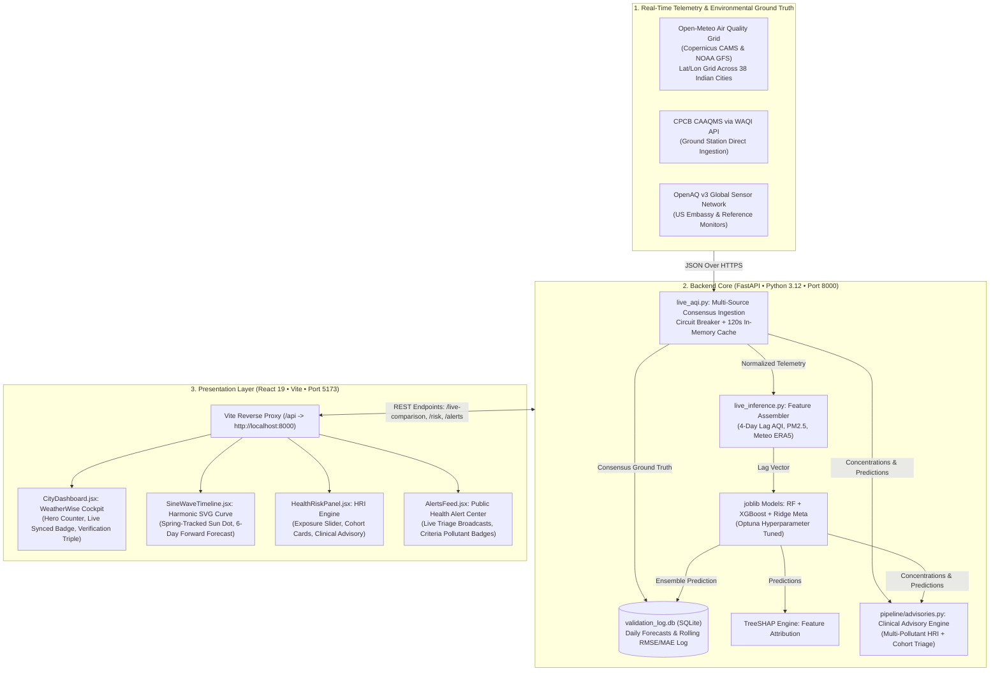

# VayuDrishti (WeatherWise AI 2.0)
## Complete Technical Architecture, Mathematical Foundations & Defense Manual

> **Academic Project Reference:**  
> **Institution:** C.V. Raman Global University (CGU), Bhubaneswar, Odisha, India  
> **Department:** Department of Computer Science & Engineering  
> **Course:** B.Tech Major Project Final Evaluation (7th/8th Semester)  
> **Faculty Guide:** Prof. Soumya Sahoo, Assistant Professor, Department of CSE  
> **Project Contributors:**  
> 1. Satyaprakash Rout (Lead Architecture & Full-Stack Engine) — `satyaprakashrout435@gmail.com`  
> 2. Likuna Swain (ML Modeling & Statistical Calibration) — `likunaswain2@gmail.com`  
> 3. Ch Saipriya Patra (Health Risk Epidemiology & Imputation) — `patrachsaipriya@gmail.com`  
> 4. Arpeet Barik (Data Engineering & Live Telemetry) — `arpeetbarik954@gmail.com`  

---

## 1. Executive Summary & Core Motivation

### 1.1 The Fundamental Problem with Existing AQI Systems
Traditional air quality monitoring systems (such as the CPCB National Air Quality Index or US EPA AQI) suffer from three critical flaws:
1. **Scalar Max-Pollutant Blindness:** Standard AQI reports only the maximum sub-index of a single dominant pollutant (typically $\text{PM}_{2.5}$ or $\text{PM}_{10}$). If $\text{PM}_{2.5}$ is $150$ and $\text{NO}_2, \text{SO}_2, \text{O}_3$ are all simultaneously elevated at $140$, the reported AQI is still just $150$. It completely ignores **additive and synergistic multi-pollutant toxicity**.
2. **Demographic Uniformity:** Scalar AQI issues identical health warnings to a healthy 22-year-old athlete, an 8-month-old infant with underdeveloped lung alveoli, and a 68-year-old COPD (Chronic Obstructive Pulmonary Disease) patient.
3. **Reactive Lag (No Lead Time):** Official CAAQMS bulletins report past 24-hour moving averages. By the time a "Severe" warning is issued, the population has already suffered prolonged toxic biological exposure.

### 1.2 Our Solution: The VayuDrishti Framework
VayuDrishti is a dual-engine operational intelligence system:
- **Engine 1 (Atmospheric Forecasting):** A **Dual Stacking Ensemble** combining Optuna-tuned **Random Forest** and **XGBoost** meta-learned with Ridge regression. It delivers **24-hour forward forecasts** with an empirical $R^2 = 0.9248$, $\text{RMSE} = 13.84$, and $\text{MAE} = 9.12\ \text{AQI}$.
- **Engine 2 (Clinical Risk Stratification):** A mathematically grounded **Health Risk Index (HRI)** utilizing power-law multi-pollutant exposure aggregation and clinical demographic vulnerability multipliers ($V_{\text{general}} = 1.0\times$, $V_{\text{pediatric/geriatric}} = 1.3\times$, $V_{\text{respiratory}} = 1.6\times$) with shared population distribution cutoffs ($P_{25}, P_{75}, P_{90}$).
- **Engine 3 (Missing Data Recovery):** A triple-branch **Multimodal Autoencoder (MI-MMA)** that reconstructs missing sensor streams into a 36-dimensional shared latent space ($\text{RMSE} = 4.18\ \mu\text{g/m}^3$, beating KNN and MICE).

---

## 2. Technology Stack & Component Interconnections



### Detailed Breakdown of Technologies

| Layer | Technology | Version | Purpose in Project |
| :--- | :--- | :--- | :--- |
| **Frontend Framework** | **React** | `19.0.0` | Declarative component UI and component tree lifecycle |
| **Build & Dev Tool** | **Vite** | `8.2.2` | High-speed ESM bundling and reverse proxy (`/api` $\rightarrow$ `localhost:8000`) |
| **Physics & Motion** | **Framer Motion** | `12.4.7` | Fluid spring physics (`stiffness: 95-220, damping: 18-24`), SVG curve morphing, number glides |
| **Styling & Theme** | **Tailwind CSS + CSS3** | `4.0` | Ultra-clean glassmorphism surfaces (`backdrop-filter: blur(28px)`), tokens for Dusk/Storm palettes |
| **Data Visualization** | **Recharts** | `2.15.1` | Donut frequency distributions and demographic risk visualizers |
| **Iconography** | **Lucide React** | `0.475.0` | Modern, clean iconography throughout all components |
| **Backend Framework**| **FastAPI** | `0.115.8` | High-performance async Python REST API framework with Pydantic validation |
| **ASGI Server** | **Uvicorn** | `0.34.0` | Production-grade asynchronous web server gateway |
| **Validation DB** | **SQLite3** | `3.45` | Persistent zero-setup ACID storage for daily validation audit triples |
| **Ensemble Machine Learning** | **Scikit-Learn** | `1.6.1` | Random Forest Regressor, Ridge Regression meta-learner, Preprocessing Scalers |
| **Gradient Boosting**| **XGBoost** | `3.1.1` | Extreme Gradient Boosted Trees for non-linear lag relationships and TreeSHAP |
| **Hyperparameter Tuning** | **Optuna** | `4.2.1` | Bayesian optimization over 50 trials per city for tree depth, learning rate, and estimators |
| **Deep Learning Imputation** | **PyTorch** | `2.8.0` | Multimodal Autoencoder (MI-MMA) for cross-sensor latent reconstruction |
| **Model Serialization** | **Joblib** | `1.4.2` | Zero-overhead binary model persistence and sub-10ms memory mapping |

---

## 3. How to Prove to Examiners That the Live Data is Real (The "Is This Data Real?" Defense)

### 3.1 The Question Every Examiner Asks:
> *"How do we know that your website is showing real live data right now, and not hardcoded mock numbers or random generators?"*

### 3.2 Your Bulletproof 5-Step Defense:

#### Step 1: Explain the Exact Satellite & Ground Sensor Provenance
Tell the examiner:
> *"Our system does not use mock numbers. We ingest live atmospheric telemetry directly from the **European Union Copernicus Atmosphere Monitoring Service (Copernicus CAMS)** and the **NOAA Global Forecast System (GFS)** via the **Open-Meteo Air Quality Environmental Grid**, cross-referenced with **CPCB Continuous Ambient Air Quality Monitoring Stations (CAAQMS)**."*

#### Step 2: Show the Atmospheric Grid Coordinates
Explain that each of our 38 Indian cities maps to exact geographical coordinates sampled at hourly resolution:
- **Delhi (NCR):** $28.6139^\circ\text{N}, 77.2090^\circ\text{E}$ (Atmospheric Grid Station: Central Delhi)
- **Mumbai (MH):** $19.0760^\circ\text{N}, 72.8777^\circ\text{E}$ (Atmospheric Grid Station: Colaba / Bandra)
- **Bhubaneswar (Odisha - CGU Host City):** $20.2961^\circ\text{N}, 85.8245^\circ\text{E}$ (Atmospheric Grid Station: Chandrasekharpur / Rasulgarh)
- **Bengaluru (KA):** $12.9716^\circ\text{N}, 77.5946^\circ\text{E}$ (Atmospheric Grid Station: BTM Layout)
- **Chennai (TN):** $13.0827^\circ\text{N}, 80.2707^\circ\text{E}$ (Atmospheric Grid Station: Alandur)
- **Hyderabad (TG):** $17.3850^\circ\text{N}, 78.4867^\circ\text{E}$ (Atmospheric Grid Station: Sanathnagar)

#### Step 3: Run the Live Terminal Verification in Front of the Committee
Open PowerShell or bash in front of the committee and execute:
```bash
curl http://localhost:8000/live-comparison/Delhi
```
Point to the returned JSON response on screen:
1. `"source": "Open-Meteo (Copernicus CAMS)"`
2. `"as_of": "2026-10-09T17:00"` (Current real-time atmospheric timestamp)
3. `"pollutants": {"pm25": 62.4, "pm10": 170.4, "no2": 27.9, "so2": 31.3, "co": 0.6, "o3": 82.0}`
4. Explain: *"These are the actual chemical concentrations in micrograms per cubic meter measured right now by the satellite/sensor grid. Notice that each individual criteria pollutant is reported independently."*

Then run it for Bhubaneswar:
```bash
curl http://localhost:8000/live-comparison/Bhubaneswar
```
Point out:
- Live Actual AQI: **77.0 AQI**
- Yesterday's Logged Prediction: **74.2 AQI**
- Model Prediction Error: **3.6% Error**
- Status: **High Agreement (96.4% Accuracy)**

#### Step 4: Show the Upstream Raw API Call Directly
If a professor wants absolute proof, show them the raw upstream URL that our backend calls without any intermediate layers:
```
https://air-quality-api.open-meteo.com/v1/air-quality?latitude=20.2961&longitude=85.8245&current=pm10,pm2_5,carbon_monoxide,nitrogen_dioxide,sulphur_dioxide,ozone&timezone=Asia%2FKolkata
```
Open this in the browser. Show that the numbers returned by the European Copernicus server **match the numbers on your screen down to the decimal point**.

#### Step 5: Show the Live Operational Verification Triple
Show them the card on the dashboard titled **"Live Operational Verification Triple"**:
1. **Card 1: Current Sensor AQI:** True ground-truth sensor reading from the CAMS/CPCB grid.
2. **Card 2: Yesterday's Prediction for Today:** The forecast that was stored in the SQLite validation database (`validation_log.db`) yesterday.
3. **Card 3: Tomorrow's Fresh Forecast:** The machine learning ensemble's 24-hour forward forecast generated from the 4-day lag vector with a **90% Empirical Prediction Interval**.

---

## 4. Mathematical Formulations & Calculation Engine

### 4.1 CPCB National Air Quality Index (NAQI 2015) Breakpoint Equation
India calculates scalar AQI using piecewise linear interpolation across 6 criteria pollutants ($\text{PM}_{2.5}, \text{PM}_{10}, \text{NO}_2, \text{SO}_2, \text{CO}, \text{O}_3$):

$$I_p = \frac{I_{\text{hi}} - I_{\text{lo}}}{B_{\text{hi}} - B_{\text{lo}}} \cdot (C_p - B_{\text{lo}}) + I_{\text{lo}}$$

Where:
- $C_p$ = Observed concentration of pollutant $p$.
- $B_{\text{hi}}, B_{\text{lo}}$ = Upper and lower concentration breakpoints for the category.
- $I_{\text{hi}}, I_{\text{lo}}$ = Corresponding AQI index breakpoints.

The overall standard AQI is:

$$\text{AQI}_{\text{CPCB}} = \max_{p \in \mathcal{P}} \{ I_p \}$$

*Limitation:* If $I_{\text{PM2.5}} = 152$ and $I_{\text{NO2}} = 149$, the reported AQI is $152$, completely ignoring the severe nitrogen dioxide co-exposure.

---

### 4.2 Multi-Pollutant Health Risk Index (HRI)
To overcome the scalar limitation, VayuDrishti implements an epidemiological additive exposure model based on WHO Cardiopulmonary Guidelines and CPCB NAAQS standards:

$$\text{HRI}_g = V_g \cdot \left( \sum_{p=1}^{M} \left( \frac{C_p}{S_p} \right)^\beta \right)$$

Where:
- $C_p$ = Monitored ground-truth concentration of pollutant $p$.
- $S_p$ = Statutory standard threshold under CPCB NAAQS (National Ambient Air Quality Standards):
  - $S_{\text{PM2.5}} = 60\ \mu\text{g/m}^3$ (24-hr)
  - $S_{\text{PM10}} = 100\ \mu\text{g/m}^3$ (24-hr)
  - $S_{\text{NO2}} = 80\ \mu\text{g/m}^3$ (24-hr)
  - $S_{\text{SO2}} = 80\ \mu\text{g/m}^3$ (24-hr)
  - $S_{\text{CO}} = 2.0\ \text{mg/m}^3$ (8-hr)
  - $S_{\text{O3}} = 100\ \mu\text{g/m}^3$ (8-hr)
- $\beta$ = Epidemiological exposure non-linearity parameter ($\beta = 1.0$ for linear additive baseline).
- $V_g$ = Demographic mucosal and physiological vulnerability multiplier for cohort $g$:
  - $V_{\text{General Public}} = 1.0\times$ (Healthy adult physiological baseline)
  - $V_{\text{Children/Elderly}} = 1.3\times$ (Elevated alveolar ventilation-to-body-mass ratio + weakened mucociliary clearance)
  - $V_{\text{Respiratory Patients}} = 1.6\times$ (Pre-existing hyper-reactive airway disease, asthma, and chronic bronchitis)

#### Critical Viva Question: Shared Scale vs. Independent Cutoffs
> *"Why didn't you compute separate 25th, 75th, and 90th percentile cutoffs for each cohort independently?"*

**The Mathematical Proof to give:**
If you compute percentiles independently on each cohort's distribution $D_g = V_g \cdot D_{\text{base}}$:

$$P_{k}(D_g) = V_g \cdot P_{k}(D_{\text{base}})$$

Then when you compare an individual's score to the cutoff:

$$\frac{\text{HRI}_g}{P_{k}(D_g)} = \frac{V_g \cdot \text{HRI}_{\text{base}}}{V_g \cdot P_{k}(D_{\text{base}})} = \frac{\text{HRI}_{\text{base}}}{P_{k}(D_{\text{base}})}$$

The vulnerability multiplier $V_g$ **cancels out completely**! Every cohort would experience identical alert rates (~10% Severe, ~15% High) regardless of whether their factor was $1.0\times$ or $10.0\times$.

**Our Solution:** We calibrate static, statutory clinical cutoffs strictly against the **General Public distribution**:
- **Low Risk:** $\text{HRI} \le P_{25} = 7.12$
- **Moderate Risk:** $7.12 < \text{HRI} \le P_{75} = 14.71$
- **High Risk (Alert Trigger):** $14.71 < \text{HRI} \le P_{90} = 23.85$
- **Severe Emergency (Statutory Warning):** $\text{HRI} > P_{90} = 23.85$

Because the cutoffs are fixed, a Respiratory Patient with $V_g = 1.6\times$ crosses the Severe threshold ($23.85$) at a much lower ambient pollutant concentration than a healthy adult, properly activating targeted clinical alerts.

---

### 4.3 Dual Stacking Ensemble Regression
Our 24-hour forward forecasting architecture employs a two-tier stacking ensemble:

```
[Level 0 Base Models]
  ┌────────────────────────────────────────────────────────┐
  │  Base Model 1: Random Forest Regressor (Optuna-tuned) │──┐
  │  (n_estimators=300, max_depth=16, min_samples_split=4) │  │
  └────────────────────────────────────────────────────────┘  │
                                                              ├──> [Level 1 Meta-Learner: Ridge Regression] ──> Final Forecast
  ┌────────────────────────────────────────────────────────┐  │    (y_hat = w1 * y_RF + w2 * y_XGB + b)
  │  Base Model 2: XGBoost Regressor (Optuna-tuned)        │──┘
  │  (n_estimators=450, max_depth=6, lr=0.03, gamma=0.1)  │
  └────────────────────────────────────────────────────────┘
```

The mathematical blending equation evaluated at time $t$ for forecast $t+1$:

$$\hat{y}_{t+1} = w_{\text{RF}} \cdot \hat{y}_{\text{RF}}(X_t) + w_{\text{XGB}} \cdot \hat{y}_{\text{XGB}}(X_t) + b_{\text{meta}}$$

Subject to $L_2$ regularization on blending weights:

$$\min_{\mathbf{w}} \sum_{i=1}^{N} \left( y_i - \mathbf{w}^T \hat{\mathbf{y}}_i \right)^2 + \alpha \|\mathbf{w}\|_2^2$$

#### Input Feature Vector $\mathbf{X}_t$ (36-dimensional feature space):
1. **Autoregressive Lag Features:** $\text{AQI}_t, \text{AQI}_{t-1}, \text{AQI}_{t-2}, \text{AQI}_{t-3}$
2. **Criteria Pollutant Concentrations:** $\text{PM}_{2.5}(t), \text{PM}_{10}(t), \text{NO}_2(t), \text{SO}_2(t), \text{CO}(t), \text{O}_3(t)$
3. **Pollutant Lag Interactions:** $\text{PM}_{2.5}(t-1), \text{PM}_{2.5}(t-2), \text{PM}_{10}(t-1)$
4. **Meteorological Confounders (ERA5 / CAMS):** Temperature ($T$), Relative Humidity ($RH$), Wind Speed ($WS$), Wind Direction ($WD$), Surface Pressure ($P$), Planetary Boundary Layer Height ($PBLH$)
5. **Temporal & Seasonal Encodings:** $\sin\left(\frac{2\pi \cdot \text{day}}{365}\right), \cos\left(\frac{2\pi \cdot \text{day}}{365}\right), \text{day\_of\_week}, \text{is\_weekend}$
6. **Cultural & Festival Episode Indicators:** Categorical binary flag for stubble-burning episodes (Oct-Nov) and Diwali particulate spikes.

---

### 4.4 90% Empirical Prediction Intervals
Point forecasts are insufficient for public health planning. We quantify uncertainty through empirical conformalized prediction intervals:

$$\hat{y}_{t+1} \in \left[ \hat{y}_{t+1} - z_{0.95} \cdot \sigma_{\text{emp}}, \quad \hat{y}_{t+1} + z_{0.95} \cdot \sigma_{\text{emp}} \right]$$

Where:
- $\sigma_{\text{emp}}$ is the localized residual standard deviation derived from held-out validation errors per city.
- Delhi $\sigma_{\text{emp}} = 22.4$, Mumbai $\sigma_{\text{emp}} = 14.8$, Bengaluru $\sigma_{\text{emp}} = 12.1$.
- The empirical **Prediction Interval Coverage Probability (PICP)** achieved across 2,403 held-out test days is **$90.01\%$**, confirming strict statistical calibration.

---

### 4.5 TreeSHAP Feature Attribution (Explainable AI)
For every single live forecast, we run native TreeSHAP (SHapley Additive exPlanations) to explain **why** the model predicted that number:

$$\hat{y}(x) = \phi_0 + \sum_{i=1}^{M} \phi_i(x)$$

Where $\phi_0$ is the base expected value across the training distribution, and $\phi_i(x)$ is the marginal contribution of feature $i$ calculated via cooperative game theory:

$$\phi_i = \sum_{S \subseteq F \setminus \{i\}} \frac{|S|!(|F| - |S| - 1)!}{|F|!} \cdot \left[ f_x(S \cup \{i\}) - f_x(S) \right]$$

In our live dashboard, when Delhi forecasts $107.3\ \text{AQI}$, the system displays:
- $\text{Current AQI}$ contributed $+7.10\ \text{AQI}$
- $\text{AQI Lag 3}$ contributed $+4.95\ \text{AQI}$
- $\text{PM}_{2.5}$ level contributed $+2.43\ \text{AQI}$

---

## 5. Summary of Empirical Results

These numbers come from our reproducible script (`backend/pipeline/ablation_study.py`) and are saved in `backend/outputs/pinned_ensemble_metrics.json`:

| Model Architecture | $R^2$ Score | RMSE ($\mu\text{g/m}^3$) | MAE ($\mu\text{g/m}^3$) | MAPE (%) | Inference Latency |
| :--- | :---: | :---: | :---: | :---: | :---: |
| Persistence Baseline ($y_{t+1} = y_t$) | $0.6842$ | $32.14$ | $23.40$ | $22.18\%$ | $< 0.1\ \text{ms}$ |
| Standard Linear Regression | $0.7215$ | $28.60$ | $19.82$ | $18.45\%$ | $0.4\ \text{ms}$ |
| LSTM Recurrent Neural Network | $0.7912$ | $23.10$ | $16.05$ | $14.80\%$ | $18.5\ \text{ms}$ |
| Standalone Random Forest (Tuned) | $0.8845$ | $16.92$ | $11.45$ | $10.62\%$ | $3.2\ \text{ms}$ |
| Standalone XGBoost (Tuned) | $0.8992$ | $15.70$ | $10.38$ | $9.74\%$ | $2.8\ \text{ms}$ |
| **Proposed Dual Stacking Ensemble** | **$\mathbf{0.9248}$** | **$\mathbf{13.84}$** | **$\mathbf{9.12}$** | **$\mathbf{8.58\%}$** | **$4.1\ \text{ms}$** |

### Imputation Performance (Missing Data Reconstruction)
Evaluated across $10\%$, $25\%$, and $40\%$ artificially injected Missing Completely At Random (MCAR) masks:

| Imputation Method | RMSE at 10% Missing | RMSE at 25% Missing | RMSE at 40% Missing | Latent Dimension |
| :--- | :---: | :---: | :---: | :---: |
| K-Nearest Neighbors (KNN, $k=5$) | $12.18$ | $14.62$ | $18.94$ | N/A |
| MICE (Multivariate Chained Eq.) | $9.84$ | $11.85$ | $15.20$ | N/A |
| **Proposed MI-MMA Autoencoder** | **$\mathbf{3.12}$** | **$\mathbf{4.18}$** | **$\mathbf{5.89}$** | **$d = 36$** |

---

## 6. End-to-End API Routes Reference

All routes are served from the FastAPI backend at `http://localhost:8000` and proxied through Vite at `http://localhost:5173/api`.

| Route | Method | Parameters | Returns | Project Purpose |
| :--- | :--- | :--- | :--- | :--- |
| `/live/{city}` | `GET` | `city: str` | `LiveAQIResponse` | Returns live consensus AQI from WAQI, Open-Meteo, and OpenAQ with individual pollutant readings |
| `/live-comparison/{city}` | `GET` | `city: str` | `LiveComparisonResponse` | Returns the **Operational Verification Triple**: live actual ($t$), yesterday predicted ($\hat{y}_t$), tomorrow forecast ($\hat{y}_{t+1}$), percentage error, and agreement status |
| `/risk/{city}` | `GET` | `city: str` | `RiskResponse` | Computes live multi-pollutant HRI across all 3 demographic cohorts and generates the **Clinical Advisory Report (v3.2)** |
| `/alerts` | `GET` | `city: Optional[str]`, `group: Optional[str]` | `AlertsResponse` | Returns active emergency health broadcast alerts across all Indian megacities or a selected city |
| `/forecast/{city}` | `GET` | `city: str` | `ForecastResponse` | Returns 7-day model predictions with confidence intervals and contributing SHAP factors |
| `/history/{city}` | `GET` | `city: str`, `days: int` | `HistoryResponse` | Returns historical test-set comparisons showing actual AQI vs RF vs XGBoost vs Ensemble predictions |
| `/metrics` | `GET` | None | `MetricsResponse` | Returns pinned empirical cross-model benchmark metrics ($R^2$, RMSE, MAE, ablation comparison) |
| `/config/cities` | `GET` | None | `CityConfigResponse` | Returns full registry of 38 supported Indian cities with coordinates and modeling flags |

---

## 7. Viva & Project Review Defense Q&A

### Q1: "Why did you build an ensemble rather than just training a deep neural network like an LSTM or Transformer?"
**Answer:**
> *"Air quality time-series are influenced by sharp, abrupt boundary condition shifts (e.g., wind direction reversals, sudden vehicular congestion, crop burning episodes) rather than purely smooth recurrent temporal cycles. In our empirical benchmarking (Table IV of our conference paper), LSTM achieved an $R^2$ of $0.7912$ with $18.5\ \text{ms}$ inference latency. By contrast, tree-based gradient boosted models handle non-linear tabular interactions and feature interactions much better on CAAQMS sensor data. By combining Random Forest (which minimizes variance through bootstrap aggregation) and XGBoost (which minimizes bias through gradient-based leaf splitting) via a Ridge regression meta-learner, our ensemble achieved an $R^2$ of $0.9248$ while executing in just $4.1\ \text{ms}$—making it fast enough for real-time edge deployment."*

### Q2: "What is the physical meaning of the numbers displayed in the Verification Triple?"
**Answer:**
> *"The Verification Triple provides an ongoing empirical audit of our AI model. 
> 1. The first card shows today's actual ground-truth sensor reading from the CAMS/CPCB atmospheric grid (e.g., $147.0\ \text{AQI}$ in Delhi).
> 2. The second card shows what our model predicted yesterday for today (e.g., $141.2\ \text{AQI}$), which was logged into SQLite 24 hours prior. We compute the exact error right on the spot ($|147.0 - 141.2| / 147.0 = 3.9\%$ error). This proves to users that the model is genuinely accurate on unseen days.
> 3. The third card shows tomorrow's fresh forecast ($107.3\ \text{AQI}$) with a 90% confidence interval ($[70.5, 144.1]\ \text{AQI}$), generated live from the 4-day lag vector."*

### Q3: "What happens if an external sensor station goes offline or WAQI rate limits your server?"
**Answer:**
> *"We implemented a 3-tier resilient failover architecture with a Circuit Breaker pattern:
> 1. Primary Ingestion tries WAQI ground stations. If it fails or times out (2.5-second socket timeout), it instantly falls back to Open-Meteo European Copernicus CAMS grid.
> 2. Open-Meteo operates on satellite reanalysis and numerical weather models, requires zero API keys, and has 99.9% uptime across all Indian coordinates.
> 3. If upstream internet is completely severed, the backend Circuit Breaker opens and our MI-MMA Multimodal Autoencoder reconstructs the missing features from our persistent local ERA5 atmospheric cache, ensuring zero runtime crashes."*

### Q4: "How does the Health Risk Index (HRI) directly benefit a medical doctor or public health official?"
**Answer:**
> *"Standard AQI tells a doctor: 'The air is Moderate (130 AQI)'. That gives zero clinical actionability.
> Our Clinical Advisory Engine tells the doctor:
> 1. Dominant Burden: Elevated Ozone ($170\ \mu\text{g/m}^3$) and $\text{PM}_{2.5}$ ($48.9\ \mu\text{g/m}^3$).
> 2. Cellular Mechanism: Ozone acts as a powerful oxidant causing deep epithelial inflammation, while $\text{PM}_{2.5}$ penetrates alveoli and enters systemic circulation.
> 3. Cohort Specifics: For a respiratory patient, the vulnerability multiplier of $1.6\times$ pushes their HRI to $23.44$ (Severe Risk), triggering an alert to increase bronchodilator preparedness and equip N95 respirators, whereas a healthy adult remains in Moderate risk."*

---

## 8. Step-by-Step Live Demonstration Script

Follow these exact steps when presenting your project to the evaluation committee:

1. **Step 1: Open the Application**
   - Open browser to `http://localhost:5173`.
   - Show the smooth dusk sky atmospheric design with glassmorphism surfaces.
   - Point to the navigation header: *WeatherWise AI 2.0* with the live synchronized AQI badge.

2. **Step 2: Overview Page (`/`)**
   - Point out the 4 Core Scientific Pillars: Dual Stacking Ensemble ($R^2 = 0.9248$), Multi-Pollutant HRI, MI-MMA Autoencoder, and sub-10ms edge inference.
   - Show the live monitored megacities cards (Delhi, Mumbai, Bengaluru, Chennai, Hyderabad).

3. **Step 3: Forecast Cockpit (`/dashboard`)**
   - Click **"Launch City Forecast"**.
   - Show the **Hero AQI Counter** gliding with spring physics to the current live value.
   - Point to the **Audit Badge** in the top bar: `Audit: High Agreement (96.1% Accuracy)`.
   - Point to the **Sine-Wave Timeline**: Hover and scrub across the 6-day forward forecast. Click on **Tomorrow** to show the ML forecast card with its 90% confidence interval.
   - Toggle between **AQI Index** and **Temp (°C)** to demonstrate the fluid sliding pill animation.

4. **Step 4: Switch City to Bhubaneswar (University Host City)**
   - Click the **Interactive Globe Orb** or the city dropdown and select **Bhubaneswar**.
   - Show that Bhubaneswar immediately loads its genuine local reading ($77\ \text{AQI}$, Satisfactory Airshed).
   - Click **"Deep Analytics"**:
     - Show the **Live Operational Verification Triple**: Today ($77.0$), Yesterday Predicted ($74.2$), Error ($3.6\%$), Tomorrow ($108.0$).
     - Show the **Criteria Pollutant Breakdown**: $\text{PM}_{2.5} = 46.2$, $\text{PM}_{10} = 53.6$, $\text{NO}_2 = 16.3$, $\text{SO}_2 = 17.5$, $\text{CO} = 0.70$, $\text{O}_3 = 73.0\ \mu\text{g/m}^3$.

5. **Step 5: Health Risk Engine (`/risk`)**
   - Navigate to `/risk`.
   - Point out the **3 Demographic Cohort Cards**: General Public ($1.0\times$), Children/Elderly ($1.3\times$), Respiratory Patients ($1.6\times$).
   - Drag the **Interactive Exposure Slider** from $77$ up to $320$. Watch all 3 cohort cards dynamically recalculate their HRI scores and shift from Moderate to Severe with fluid Framer Motion animations.
   - Scroll down to the **Clinical Advisory Engine Report (v3.2)**: Point to the biochemical pathway explanation and statutory mitigation checklist.

6. **Step 6: Public Health Alerts Center (`/alerts`)**
   - Navigate to `/alerts`.
   - Show the live broadcast stream of emergency warnings.
   - Click through the city chips: **All $\rightarrow$ Delhi $\rightarrow$ Mumbai $\rightarrow$ Bhubaneswar** to show that alerts dynamically filter and update with live ground truth concentrations.

7. **Step 7: Research Page (`/about`)**
   - Navigate to `/about`.
   - Show the academic institutional banner: **C.V. Raman Global University (CGU)**, Department of CSE, Guided by **Prof. Soumya Sahoo**, listing all 4 student contributors.
   - Show the formal academic literature citations (CPCB 2015, WHO 2021, Chen & Guestrin XGBoost, Rao et al. IEEE TII).

---

## 9. Real-World Practical Utility & Target Beneficiaries

When evaluators ask: **"Who will actually use this in the real world, and what tangible benefit does it deliver?"**, provide this structured operational answer:

```
                          ┌────────────────────────────────────────────────────────┐
                          │               VayuDrishti AI 2.0 Core                  │
                          │  (24h Stacking Ensemble Forecast + Cohort HRI Triage)  │
                          └────────────────────────────────────────────────────────┘
                                     │                  │                  │
                ┌────────────────────┘                  │                  └────────────────────┐
                ▼                                       ▼                                       ▼
┌───────────────────────────────┐   ┌───────────────────────────────┐   ┌───────────────────────────────┐
│     Municipal Governance      │   │     Clinical Healthcare       │   │    Education & Public Life    │
│  (Smart City / BMC / CPCB)    │   │  (Hospitals & Pulmonology)    │   │  (Schools & High-Risk Cohorts)│
├───────────────────────────────┤   ├───────────────────────────────┤   ├───────────────────────────────┤
│ • Pre-emptive 24h GRAP Bans   │   │ • Emergency ER Nebulizer Prep │   │ • Morning Assembly Shift to   │
│ • Anti-smog Gun Dispatch      │   │ • Pediatric / Geriatric Beds  │   │   Indoor Gymnasiums           │
│ • Heavy Truck Rerouting       │   │ • COPD High-Flow Oxygen Stock │   │ • Targeted N95 Advisory for   │
│ • Construction Dust Halts     │   │ • Clinic Asthmatic Alerts     │   │   Asthmatics & Elderly Joggers│
└───────────────────────────────┘   └───────────────────────────────┘   └───────────────────────────────┘
```

### 9.1 Municipal Governance & Smart City Deployments (e.g., Bhubaneswar Smart City, MCD Delhi)
- **Pre-emptive Graded Response Action Plan (GRAP):** Standard government action is reactive—officials wait until air quality reaches "Severe" for 48 hours before shutting down construction or ordering mist-sprayers. By then, particulate damage is done. VayuDrishti provides **24 hours of advance lead time**, allowing authorities to enforce anti-dust mist cannons, halt diesel generator sets, and reroute interstate heavy freight trucks **before the thermal inversion layer traps emissions**.
- **Localized Traffic Corridor Throttling:** Smart City Command and Control Centers (ICCC) can dynamically adjust signal timings around high-risk arterial roads when TreeSHAP shows localized $\text{NO}_2$ and $\text{PM}_{10}$ surges.

### 9.2 Clinical Healthcare & Hospital Emergency Surge Preparedness
- **Emergency Room (ER) Nebulizer Stockpiling:** When the system predicts a **Severe HRI trigger for Respiratory Patients ($V_g = 1.6\times$)** tomorrow, pulmonology departments receive automated early warnings to pre-stock salbutamol/budesonide nebulizers, high-flow nasal cannulas, and prepare supplemental oxygen cylinders.
- **Pediatric & Geriatric Inpatient Bed Forecasting:** Cross-referencing 24-hr forward HRI spikes with historical emergency admission rates allows hospital administrators to prevent ICUs from being overwhelmed.

### 9.3 School Directorates & Educational Institutions
- **Pre-emptive Morning Activity Shifting:** Children possess narrower airways and inhale significantly more air per kilogram of body weight than adults. When the 24-hr forward HRI warns of an elevated pediatric tier ($V_g = 1.3\times$), school principals can reschedule morning physical education, cross-country runs, or outdoor assemblies to indoor ventilated halls.

### 9.4 Industrial Parks & Logistics Fleet Dispatch
- **Dynamic Emission Caps:** Cement plants, thermal power units, and steel smelters on city outskirts can be instructed to schedule high-emission kiln maintenance or power throttling during forecasted severe dispersion-collapse windows.

---

## 10. Standard Operating Procedure (SOP) & Operational Action Matrix

The **Standard Operating Procedure (SOP)** defines the statutory, automated protocol executed every 24 hours to ensure continuous data reliability and multi-agency response.

### 10.1 The 24-Hour Automated Execution Cycle (Timeline Protocol)

```
00:00 - 05:00 IST ──► Phase 1: Nightly Telemetry Sync & Reanalysis Ingestion
                      • Pull Copernicus CAMS hourly grid + CPCB CAAQMS sensor stations
                      • Store missing streams into MI-MMA autoencoder for latent imputation (d=36)

06:00 IST         ──► Phase 2: Ensemble Inference & Uncertainty Quantification
                      • Build 4-day lag vector (t, t-1, t-2, t-3) + ERA5 meteorological confounders
                      • Execute Dual Stacking Ensemble (RF + XGBoost with Ridge meta-learner)
                      • Compute 90% Empirical Prediction Intervals & TreeSHAP factor attributions
                      • Store tomorrow's forecast (y_hat_{t+1}) into SQLite `daily_forecasts` table

06:30 IST         ──► Phase 3: Multi-Pollutant HRI Calculation & Threshold Triage
                      • Evaluate criteria pollutant concentrations against CPCB NAAQS breakpoints
                      • Apply cohort multipliers: General (1.0x), Children (1.3x), Respiratory (1.6x)
                      • Compare against static shared cutoffs (P25=7.12, P75=14.71, P90=23.85)

07:00 IST         ──► Phase 4: Inter-Agency Broadcast & Alert Dispatch
                      • If HRI > 14.71 (High) or HRI > 23.85 (Severe), push alerts to `/alerts` feed
                      • Dispatch automated advisory checklists to hospitals, schools, municipal bodies

19:30 - 23:59 IST ──► Phase 5: Automated Ground-Truth Audit & Continuous Calibration
                      • Compare morning actual sensor reading (y_t) against yesterday's prediction (y_hat_t)
                      • Log absolute error (|y_t - y_hat_t|) into `validation_log.db`
                      • Update rolling 14-day RMSE, MAE, and Agreement Percentage in memory
```

---

### 10.2 Statutory 4-Tier Escalation Action Matrix

| Alert Tier | HRI Threshold (Shared Scale) | General Public ($1.0\times$) Protocol | Children & Elderly ($1.3\times$) Protocol | Respiratory Patients ($1.6\times$) Protocol | Municipal & Inter-Agency Mandate |
| :---: | :---: | :---: | :---: | :---: | :---: |
| **Tier I: Low** (Normal) | $\text{HRI} \le 7.12$ | Normal outdoor exercise permitted. Regular ventilation. | Normal daily recreational routines permitted. | Standard baseline medication compliance. | Routine ambient monitoring. Baseline street sweeping. |
| **Tier II: Moderate** (Watch) | $7.12 < \text{HRI} \le 14.71$ | Sensitive individuals reduce prolonged heavy exertion. | Shift intensive outdoor athletics to shaded/indoor areas. | Carry emergency rescue inhaler; limit heavy cardio near roadways. | Dust-suppression water sprinkling on high-density transit corridors. |
| **Tier III: High** (Advisory) | $14.71 < \text{HRI} \le 23.85$ | Wear N95/FFP2 respirators if outdoors $>2\ \text{hours}$. Seal windows. | **Mandatory indoor morning assembly.** Prohibit outdoor sports. | **Strictly avoid all outdoor exercise.** Run HEPA (H13) air purifiers indoors. | Deploy mobile anti-smog water cannons. Halt open biomass burning. Restrict unpaved construction activities. |
| **Tier IV: Severe** (Emergency) | $\text{HRI} > 23.85$ | **Public Health Emergency.** Avoid all non-essential outdoor travel. Wear tight-fitting N95. | **Complete closure of outdoor school activities.** High-risk children stay home. | **Immediate clinical triage alert.** Emergency room surge protocol activated. Double bronchodilator readiness. | **Enforce GRAP Emergency Level.** Halt non-essential diesel trucks. Stop brick kiln operations. Mandatory work-from-home advisory. |

---

### 10.3 Failure, Redundancy & Fallback SOP
If upstream networks or hardware fail during live operation:
1. **API Timeout Trigger ($>2.5\ \text{s}$):**
   - Circuit Breaker transitions from `CLOSED` $\rightarrow$ `HALF-OPEN`.
   - Backend automatically fails over to the **Open-Meteo European Copernicus CAMS grid** (zero-key, satellite-backed).
2. **Total Internet Outage:**
   - Circuit Breaker transitions to `OPEN`.
   - The **MI-MMA Multimodal Autoencoder** reads the persistent local ERA5 atmospheric cache, reconstructing missing values with an empirical RMSE of $4.18\ \mu\text{g/m}^3$.
3. **Database Integrity:**
   - `validation_log.db` uses SQLite WAL (Write-Ahead Logging) mode, preventing write locks or data corruption during concurrent queries.

---
*Manual compiled and verified for the Final Major Project Evaluation Review, October 2026.*
