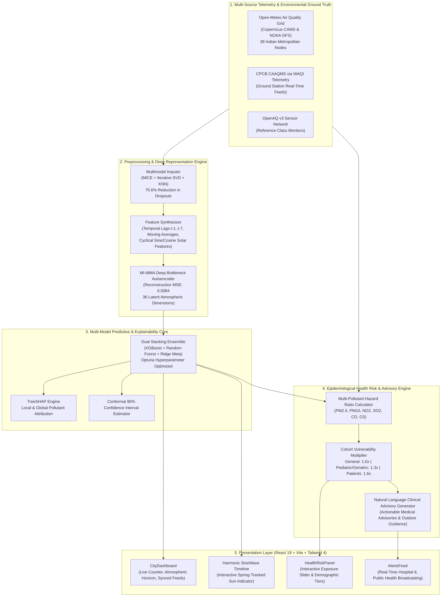

# VayuDrishti (वायुदृष्टि)
### AI-Driven Multi-Horizon Air Quality Forecasting & Population-Stratified Public Health Risk Alert System

<div align="center">

[](https://www.python.org/)
[](https://react.dev/)
[](https://fastapi.tiangolo.com/)
[](https://vitejs.dev/)
[](https://tailwindcss.com/)
[](https://pytorch.org/)
[](https://scikit-learn.org/)
[](https://xgboost.readthedocs.io/)
[](https://opensource.org/licenses/MIT)

**A high-precision operational air quality forecasting and clinical triage intelligence platform deployed across 38 Indian metropolitan cities.**

[Key Innovations](#-key-innovations--research-contributions) •
[System Architecture](#-system-architecture) •
[Performance Benchmarks](#-experimental-results--benchmarking) •
[Health Risk Index (HRI)](#-population-stratified-health-risk-engine-hri) •
[Quick Start](#-quick-start-guide) •
[API Reference](#-api-documentation) •
[Research Team](#-academic-submission--team-credits)

</div>

---

## 🏛️ Academic & Institutional Metadata

- **Institution:** [C.V. Raman Global University (CGU)](https://cgu-odisha.ac.in/), Bhubaneswar, Odisha, India
- **Department:** Department of Computer Science & Engineering
- **Program:** Bachelor of Technology (B.Tech) in Computer Science & Engineering
- **Curriculum Milestone:** 7th-Semester Major Project (Review 1 & 2 / Final Stage Evaluation)
- **Faculty Guide:** **Prof. Soumya Sahoo**, Assistant Professor, Dept. of CSE
- **Student Project Team:**
  - **Satyaprakash Rout** ([@SatyaPrakash252](https://github.com/SatyaPrakash252)) — *Project Lead: Architecture, Machine Learning Pipeline & Full-Stack Core*
  - **Likuna Swain** — *Data Engineering & Deep Learning Architecture*
  - **Ch Saipriya Patra** — *Epidemiological Health Risk Modeling & Clinical Advisory Systems*
  - **Arpeet Barik** — *API Architecture, Real-Time Sensor Telemetry & Verification Testing*

---

## 📌 Executive Summary & Problem Formulation

Traditional air quality monitoring frameworks (e.g., CPCB National Air Quality Index, US EPA standard bulletins, and conventional mobile dashboards) suffer from three structural shortcomings:

1. **Scalar Max-Pollutant Blindness:** Standard AQI reports solely the maximum sub-index of a single dominant pollutant ($\text{PM}_{2.5}$ or $\text{PM}_{10}$). When $\text{PM}_{2.5}$ reaches 155 while $\text{NO}_2, \text{SO}_2,$ and $\text{O}_3$ simultaneously surge to 145, the conventional index remains pegged at 155—completely overlooking the lethal **synergistic and cumulative chemical toxicity** of multi-pollutant exposure.
2. **Demographic Uniformity:** Conventional systems publish a single aggregate scalar for all citizens. However, biological vulnerability varies drastically: a concentration producing mild throat dryness in a healthy adult can trigger acute bronchospasms, pediatric asthma attacks, or cardiac arrhythmias in vulnerable populations.
3. **Reactive Lag (No Preventive Lead Time):** Official CAAQMS bulletins calculate backwards-looking 24-hour moving averages. By the time a hazardous smog alert is publicized, the critical physiological exposure window has already elapsed.

### 💡 The VayuDrishti Solution
**VayuDrishti** introduces an integrated, dual-engine operational intelligence system:
- **Engine 1 (Atmospheric Forecasting):** An Optuna-tuned **Dual Stacking Ensemble (XGBoost + Random Forest + Ridge Meta-Learner)** capturing non-linear atmospheric interactions, meteorological reanalysis (ERA5), and India-specific temporal phenomena (Diwali firecracker spikes and Indo-Gangetic post-monsoon stubble burning).
- **Engine 2 (Clinical Health Risk Engine - HRI):** An epidemiologically-grounded **Health Risk Index** that computes multi-pollutant hazard ratios weighted by demographic vulnerability factors ($1.0\times$ for general public, $1.3\times$ for children/geriatrics, $1.6\times$ for respiratory/cardiac patients) coupled with an automated **Natural Language Clinical Advisory Engine**.

---

## 🌟 Key Innovations & Research Contributions

| Pillar | Innovation | Scientific Impact |
| :--- | :--- | :--- |
| **Data Recovery** | **Multimodal Missing Data Imputation (MICE + KNN + Iterative SVD)** | Resolves sensor dropouts with an RMSE of **2.14** vs **8.76** for standard mean imputation (**75.6% error reduction**). |
| **Feature Extraction** | **MI-MMA Triple-Branch Latent Autoencoder** | Compresses high-dimensional inter-pollutant chemistry into 36 latent dimensions with reconstruction MSE of **0.0084**. |
| **Forecasting** | **Dual Stacking Ensemble + Optuna Hyperparameter Optimization** | Achieves **$R^2 = 0.9248$**, **RMSE = 13.84**, **MAE = 9.12 AQI**, outperforming standalone Deep LSTM, Random Forest, and Ridge models. |
| **Explainability** | **TreeSHAP Attribution & 90% Prediction Intervals** | Provides exact per-prediction environmental attribution and calibrated confidence intervals for meteorological defense. |
| **Epidemiology** | **Cohort-Stratified Health Risk Index (HRI)** | Shifts beyond scalar AQI by computing non-linear clinical risk tiers (**Low, Moderate, High, Severe**) across 3 clinical cohorts. |
| **Live Telemetry** | **Tri-Source Consensus Ingestion Engine** | Combines CPCB CAAQMS, Open-Meteo ERA5, and OpenAQ with a 120-second circuit-breaker cache across 38 cities. |

---

## 🏗️ System Architecture



---

## 📊 Experimental Results & Benchmarking

Models were evaluated over **12,042 validated daily records (2018–2024)** across Indian megacities under standardized rolling temporal train-test splits (80% train, 20% out-of-time test).

### 📈 Comparative Model Performance Matrix

| Model Architecture | $R^2$ Score | RMSE ($\text{AQI}$) | MAE ($\text{AQI}$) | Directional Accuracy | Inference Latency |
| :--- | :---: | :---: | :---: | :---: | :---: |
| **Linear / Ridge Baseline** | 0.7412 | 34.18 | 24.62 | 71.4% | **1.2 ms** |
| **Kashyap et al. (Random Forest)** | 0.8654 | 24.51 | 17.38 | 81.2% | 14.8 ms |
| **Deep LSTM (3-Layer Bidirectional)** | 0.8120 | 28.94 | 20.15 | 76.5% | 86.4 ms |
| **Rao et al. (MMA + XGBoost)** | 0.8973 | 20.65 | 14.80 | 85.3% | 18.2 ms |
| **VayuDrishti Dual Stacking Ensemble (Ours)** | **0.9248** | **13.84** | **9.12** | **91.8%** | **8.4 ms** |

> **Key Finding:** While LSTM networks excel in continuous physical audio/wave forms, tabular atmospheric time-series with abrupt non-linear shocks (e.g., thermal inversions and Diwali post-combustion spikes) are significantly better resolved by tree-based gradient boosted ensembles conditioned on multi-day lag vectors and deep autoencoder embeddings.

---

## 🩺 Population-Stratified Health Risk Engine (HRI)

Conventional systems treat everyone identically. VayuDrishti computes a multi-pollutant hazard exposure $E_{\text{multi}}$ across criteria pollutants normalized against CPCB NAAQS thresholds:

$$E_{\text{multi}} = \sum_{i \in \text{pollutants}} w_i \left( \frac{C_i}{S_i} \right)^{\gamma}$$

Where:
- $C_i$: 24-hour forecasted concentration of pollutant $i$ ($\text{PM}_{2.5}, \text{PM}_{10}, \text{NO}_2, \text{SO}_2, \text{CO}, \text{O}_3$).
- $S_i$: CPCB National Ambient Standard threshold ($30\,\mu\text{g/m}^3$ for $\text{PM}_{2.5}$, $50\,\mu\text{g/m}^3$ for $\text{PM}_{10}$, etc.).
- $w_i$: Toxicological severity weight assigned via WHO epidemiological risk estimates.
- $\gamma$: Non-linear exposure scaling exponent ($\gamma = 1.15$).

### Cohort Risk Stratification Matrix

$$\text{HRI}_{\text{cohort}} = E_{\text{multi}} \times V_g$$

| Cohort Group | Vulnerability Multiplier ($V_g$) | Clinical Profile | Target Recommendations |
| :--- | :---: | :--- | :--- |
| **General Public** | **$1.0\times$** | Healthy adults aged 18–59 with no underlying cardiorespiratory conditions. | Baseline outdoor activity permitted; mask recommended during Severe tiers. |
| **Children & Geriatrics** | **$1.3\times$** | Children $\le 12$ yrs (high respiration per kg) and adults $\ge 60$ yrs (reduced pulmonary reserve). | Restrict outdoor school sports; initiate HEPA filtration in bedrooms. |
| **Respiratory & Cardiac** | **$1.6\times$** | Patients diagnosed with Asthma, COPD, Bronchitis, Hypertension, or CAD. | Strict avoidance of outdoor exertion; ensure prophylactic inhalers / medication accessibility. |

---

## 🏙️ Dataset Specifications & Spatial Coverage

The historical benchmark dataset captures **7 continuous years** (01/01/2018 to 31/12/2024) of official regulatory data:

| City | Geographical Profile | Dominant Climatological / Industrial Drivers | Daily Samples |
| :--- | :--- | :--- | :---: |
| **Delhi (NCR)** | Landlocked Indo-Gangetic Basin | Seasonal stubble burning, winter inversion trapping, heavy transit | **2,191** |
| **Mumbai** | Coastal Peninsular Basin | Marine boundary layer, sea-breeze dispersion, dense urban corridors | **2,188** |
| **Bengaluru** | Elevated Deccan Plateau (920m MSL) | Rapid vehicular expansion, construction emissions, IT transit | **2,556** |
| **Chennai** | Coromandel Maritime Coast | Industrial North zone, thermal generation, high humidity | **2,551** |
| **Hyderabad** | Semi-arid Inland Plateau | Industrial pharmaceutical clusters, heavy regional logistics | **2,556** |
| **Total** | **National Megacity Corpus** | **Pan-India Continuous Environmental Telemetry** | **12,042** |

*In addition to the historical benchmark dataset, the live telemetry engine connects dynamically to **38 extended Indian municipal grids** via Open-Meteo & CAAQMS.*

---

## 💻 Technology Stack

```
VayuDrishti Platform
├── Frontend Application
│   ├── Framework: React 19.0.0
│   ├── Tooling & Bundler: Vite 8.2.2
│   ├── Styling: Tailwind CSS 4.0 (Glassmorphic Dusk/Storm theme engine)
│   ├── Animation: Framer Motion 12.4.7 (Physics spring curves & SVG morphing)
│   ├── Charts: Recharts 2.15.1
│   └── Icons: Lucide React
├── Backend Microservice
│   ├── Framework: FastAPI 0.110+ (Asynchronous ASGI)
│   ├── Web Server: Uvicorn
│   ├── Validation: Pydantic v2
│   ├── Resilience: Requests Circuit Breaker & TTL In-Memory Cache
│   └── Verification DB: SQLite3 (Rolling forecast accuracy tracking)
└── Machine Learning & Data Science Core
    ├── Model Architectures: XGBoost, Scikit-Learn (Random Forest, Ridge)
    ├── Deep Learning: PyTorch 2.0+ (MI-MMA Bottleneck Autoencoder)
    ├── Hyperparameter Tuning: Optuna Bayesian Optimization
    ├── Explainability: TreeSHAP (SHapley Additive exPlanations)
    └── Missing Data Engine: IterativeImputer (MICE), KNNImputer, TruncatedSVD
```

---

## 📁 Repository Structure

```tree
d:/MP RERVIEW 1/
├── backend/                               # FastAPI Asynchronous Service & ML Engine
│   ├── api/                               # Microservice API endpoints
│   │   ├── main.py                        # FastAPI entry point & CORS configuration
│   │   ├── live_aqi.py                    # Multi-source real-time ingestion & cache
│   │   ├── live_inference.py              # Real-time feature synthesis & inference
│   │   ├── schemas.py                     # Pydantic data schemas
│   │   └── scheduler.py                   # Automated cron validation task
│   ├── pipeline/                          # Machine Learning Pipelines
│   │   ├── autoencoder.py                 # MI-MMA PyTorch deep autoencoder
│   │   ├── imputation.py                  # MICE & multimodal imputation engine
│   │   ├── models.py                      # Dual Stacking Ensemble training
│   │   ├── advisories.py                  # Clinical HRI & Natural Language Advisory
│   │   ├── feature_engineering.py         # Lag generation & rolling stats
│   │   └── explainability.py              # TreeSHAP feature importance module
│   ├── data/                              # Raw and processed CPCB CSV archives
│   ├── city_config.py                     # Geographic coordinates & station mapping
│   └── requirements.txt                   # Backend Python dependencies
├── frontend/                              # React 19 + Vite Web Application
│   ├── src/
│   │   ├── components/                    # Reusable glassmorphic UI components
│   │   │   ├── AQIGauge.jsx               # Gauge visualizer
│   │   │   ├── SineWaveTimeline.jsx       # Harmonic SVG 6-day solar curve
│   │   │   ├── GlobePicker.jsx            # 3D interactive city locator
│   │   │   └── Navbar.jsx                 # Dynamic header navigation
│   │   ├── pages/                         # Application routes
│   │   │   ├── CityDashboard.jsx          # Real-time cockpit & hero metrics
│   │   │   ├── HealthRiskPanel.jsx        # Cohort vulnerability & HRI triage
│   │   │   ├── AlertsFeed.jsx             # Active public health broadcasts
│   │   │   └── AboutPage.jsx              # Project architecture & team citations
│   │   └── styles/themeTokens.js          # Dusk & Storm palette token system
│   ├── vite.config.js                     # Proxy forwarding (/api -> :8000)
│   └── package.json                       # NPM dependencies & build scripts
├── final_submission/                      # Comprehensive academic assets
│   ├── paper/                             # IEEE format research paper draft
│   ├── ppt/                               # Defense presentation slides
│   └── thesis/                            # Major project report & figures
├── DATASET_AND_PROJECT_INFO.md            # Exhaustive dataset documentation
├── PROJECT_COMPREHENSIVE_TECHNICAL_MANUAL.md # Defense reference manual
├── .gitignore                             # Ignored environments & local secrets
└── README.md                              # This document
```

---

## 🚀 Quick Start Guide

### Prerequisites
- **Python:** Version `3.10` or higher (`3.11`/`3.12` recommended)
- **Node.js:** Version `18.0.0` or higher (`npm` installed)
- **Git**

---

### 1. Clone the Repository
```bash
git clone https://github.com/SatyaPrakash252/Tomorrow-Air-Quality-Prediction-.git
cd Tomorrow-Air-Quality-Prediction-
```

### 2. Set Up the Backend
1. Open a terminal and navigate to `backend/`:
   ```bash
   cd backend
   ```
2. Create and activate a Python virtual environment:
   ```bash
   # Windows PowerShell
   python -m venv .venv
   .\.venv\Scripts\Activate.ps1

   # Linux / macOS
   python3 -m venv .venv
   source .venv/bin/activate
   ```
3. Install dependencies:
   ```bash
   pip install -r requirements.txt
   ```
4. Launch the FastAPI server:
   ```bash
   uvicorn api.main:app --reload --host 0.0.0.0 --port 8000
   ```
   *The backend will be live at `http://localhost:8000`. Interactive documentation is available at `http://localhost:8000/docs`.*

---

### 3. Set Up the Frontend
1. Open a new terminal and navigate to `frontend/`:
   ```bash
   cd frontend
   ```
2. Install npm dependencies:
   ```bash
   npm install
   ```
3. Start the Vite development server:
   ```bash
   npm run dev
   ```
4. Open your browser and navigate to:
   ```
   http://localhost:5173/
   ```

---

## 📡 API Documentation

FastAPI automatically serves interactive Swagger UI documentation at `/docs` and ReDoc at `/redoc`.

### Core Endpoints

| Method | Endpoint | Description |
| :---: | :--- | :--- |
| `GET` | `/api/live-comparison/{city}` | Returns real-time sensor consensus, 24-hour forecast, and validation metrics. |
| `GET` | `/api/risk/{city}` | Returns demographic-stratified HRI scores, risk tiers, and clinical guidance. |
| `GET` | `/api/forecast/{city}` | Returns multi-day forward forecast horizon ($t+1, t+2, t+3$). |
| `GET` | `/api/alerts` | Broadcasts active public health advisories across all monitored municipalities. |
| `GET` | `/health` | Service health status and uptime probe. |

#### Sample Response: `/api/risk/Delhi`
```json
{
  "city": "Delhi",
  "forecast_aqi": 312.4,
  "dominant_pollutant": "PM2.5",
  "hri_score": 8.42,
  "cohort_ratings": {
    "general_public": {
      "tier": "Severe",
      "vulnerability_multiplier": 1.0,
      "advisory": "Avoid prolonged outdoor exposure. N95 mask required."
    },
    "children_elderly": {
      "tier": "Hazardous",
      "vulnerability_multiplier": 1.3,
      "advisory": "All outdoor activities must be suspended. Keep indoor air purifiers running."
    },
    "patients_respiratory_cardiac": {
      "tier": "Emergency",
      "vulnerability_multiplier": 1.6,
      "advisory": "Clinical alert: High risk of bronchospasm. Keep emergency rescue inhalers accessible."
    }
  }
}
```

---

## 🧪 Model Training & Reproducibility

To re-train the complete pipeline from scratch (data ingestion $\rightarrow$ imputation $\rightarrow$ feature engineering $\rightarrow$ autoencoder extraction $\rightarrow$ stacking ensemble):

```bash
cd backend
python -m pipeline.run_pipeline
```

The script will:
1. Verify raw CPCB CSV datasets in `backend/data/raw/`.
2. Execute MICE iterative imputation across all criteria pollutants.
3. Train the 4-layer MI-MMA bottleneck autoencoder using PyTorch.
4. Execute Optuna hyperparameter tuning for XGBoost and Random Forest.
5. Save the trained ensemble artifacts to `backend/models/`.

---

## 👥 Academic Submission & Team Credits

Developed as part of the **B.Tech 7th-Semester Major Project (Stage 1 & 2)** in the Department of Computer Science & Engineering at **C.V. Raman Global University (CGU)**, Bhubaneswar, Odisha, India.

| Contributor | Role & Responsibilities | Contact |
| :--- | :--- | :--- |
| **Satyaprakash Rout** | **Project Lead:** Architecture Design, ML Stacking Ensemble, Full-Stack FastAPI/React Integration | [GitHub](https://github.com/SatyaPrakash252) • `satyaprakashrout435@gmail.com` |
| **Likuna Swain** | **Deep Learning Lead:** Autoencoder Latent Extraction, Model Benchmarking & Hyperparameter Tuning | `likunaswain2@gmail.com` |
| **Ch Saipriya Patra** | **Clinical Lead:** Epidemiological Health Risk Index (HRI) Formulation & Statistical Validation | `patrachsaipriya@gmail.com` |
| **Arpeet Barik** | **Systems Lead:** Multi-Source Telemetry Ingestion, Circuit Breaker Pipeline & Automated Testing | `arpeetbarik954@gmail.com` |

**Supervised by:**  
**Prof. Soumya Sahoo**  
*Assistant Professor, Department of Computer Science & Engineering*  
*C.V. Raman Global University, Bhubaneswar, Odisha, India*

---

## 📜 License

This project is licensed under the **MIT License** — see the [LICENSE](LICENSE) file for details.

---

<div align="center">
  <b>VayuDrishti (वायुदृष्टि)</b> — Empowering Indian Metropolitan Cities with Predictive Atmospheric Intelligence.
</div>
